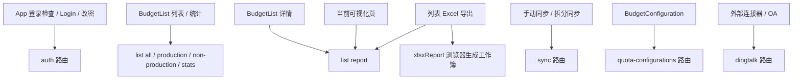

# 接口设计及调用关系

## 约定

后端统一在 `/api` 下挂载，来源为 [server/index.js](../../server/index.js)。多数接口返回 `{success,data?,message?}`，分页另有 `total/page/pageSize`。`/health` 返回 `{status,timestamp}`，`/dingtalk/querySimple` 返回 `{budgetAmount:字符串}`，SSO 入口及回调返回重定向；不要把它们统一当作同一种响应结构。

前端 [api/index.js](../../client/src/api/index.js) 使用 `VITE_API_BASE_URL || '/api'`、Cookie `withCredentials`，可配置 `X-API-Key`。默认超时 30 秒，报表 180 秒，同步 600 秒。日期/月份口径按模块核对，不能把所有 `startDate/endDate` 都理解为按申请日期筛选。

## 路由清单

下表权限来自路由实际中间件及处理器；API Key 只在配置时启用，详细放行规则见 [authentication.md](authentication.md)。

| 方法 | 路径 | 功能 / 权限 | 模块契约 |
| --- | --- | --- | --- |
| GET | `/api/health` | 进程健康信息；无登录要求、不检测数据库健康 | [部署](deployment.md) |
| POST | `/api/auth/login` | 本地账号登录；无需既有会话 | [认证接口](../modules/authentication/api.md) |
| GET | `/api/auth/me` | 返回当前用户；无会话返回 401 | 同上 |
| GET | `/api/auth/check` | 登录检查；需登录 | 同上 |
| POST | `/api/auth/logout` | 删除当前会话、清 Cookie | 同上 |
| POST | `/api/auth/change-password` | 当前用户自助改密；需登录 | 同上 |
| GET | `/api/auth/eims/start` | 发起 SSO | 同上 |
| GET | `/api/auth/eims/callback` | 验证 state 并建立本地会话 | 同上 |
| POST | `/api/auth/eims/logout` | 获取单点退出 URL 并清本地会话；需登录 | 同上 |
| GET | `/api/auth/eims/logout/callback` | 消费退出 state 并跳转 | 同上 |
| GET | `/api/list/production` | 生产预算；需登录并限制部门范围 | [预算接口](../modules/budget-applications/api.md) |
| GET | `/api/list/non-production` | 非生产预算；同上 | 同上 |
| GET | `/api/list/all` | 两类预算合并后分页；同上 | 同上 |
| GET | `/api/list/stats` | 今日/总数统计；同上 | 同上 |
| GET | `/api/list/approval` | 本地审批记录；同上，通过所属预算校验范围 | 同上 |
| GET | `/api/list/report` | 完整预算、支出和待审批数据；效率明细仅超级管理员 | [报表接口](../modules/expense-reporting/api.md) |
| POST | `/api/sync` | 预算同步、状态刷新、可选外部支出同步；仅超级管理员 | [同步接口](../modules/synchronization/api.md) |
| POST | `/api/sync/expense-splits` | 代理外部专项拆分同步；仅超级管理员 | 同上 |
| GET | `/api/config/scheduler` | 调度状态；仅超级管理员 | 同上 |
| POST | `/api/config/scheduler/start` | 启动进程内调度；仅超级管理员 | 同上 |
| POST | `/api/config/scheduler/stop` | 停止进程内调度；仅超级管理员 | 同上 |
| GET | `/api/quota-configurations/options` | 额度筛选项；仅超级管理员 | [额度接口](../modules/effective-quota/api.md) |
| GET | `/api/quota-configurations` | 额度明细和汇总；仅超级管理员 | 同上 |
| GET | `/api/dingtalk/querySimple` | 连接器预算金额；未设置 requireAuth，有会话时应用部门范围 | [集成接口](../modules/dingtalk-integration/api.md) |
| GET | `/api/dingtalk/query` | 旧预算列表查询；同上 | 同上 |
| GET | `/api/dingtalk/alert-budget-snapshot` | OA 内部快照；始终验证专用密钥 | 同上 |

定义文件：[routes/auth.js](../../server/routes/auth.js)、[routes/list.js](../../server/routes/list.js)、[routes/sync.js](../../server/routes/sync.js)、[routes/config.js](../../server/routes/config.js)、[routes/quota-configurations.js](../../server/routes/quota-configurations.js)、[routes/dingtalk.js](../../server/routes/dingtalk.js)。

## 客户端调用关系

`getAllBudgetList` 在 `/list/all` 返回 404 时兼容调用旧的两类列表再合并分页。`getBudgetDetail` 封装仍指向只返回金额的 `querySimple`，但当前详情方法 `handleOpenDetail` 调用的是 `/list/report`。`getApprovalList` 和调度控制封装已存在，当前页面链路未发现调用。证据：[api/index.js](../../client/src/api/index.js)、[BudgetList.jsx](../../client/src/pages/BudgetList.jsx)。

## 校验和异常边界

登录、改密、额度筛选/分页、预警金额有明确局部校验；列表的分页和日期并未统一采用额度的严格校验，手动同步时间也没有统一请求 DTO/schema 校验。SQL 参数值通常使用 `$n`，动态预算表名通过固定解析/白名单选择。不存在统一 OpenAPI 文件或自动 API 文档生成器。

修改接口时保持响应兼容，并核对前端调用、权限范围、日期和金额口径。具体错误码和外部降级限制见各模块 `api.md`、`workflow.md`。

当前路由没有 `/v1` 等统一版本前缀；不能依赖版本隔离随意变更契约。多数异常使用 message，部分认证使用稳定 code；新错误可渐进提供 code/参数并兼容 message，语言展示约定见 [国际化](internationalization.md)。金额、期间、部门及枚举解释见 [数据字典](data-dictionary.md)，出站请求及外部调用方认证/重试见 [集成关系](integrations.md)。
