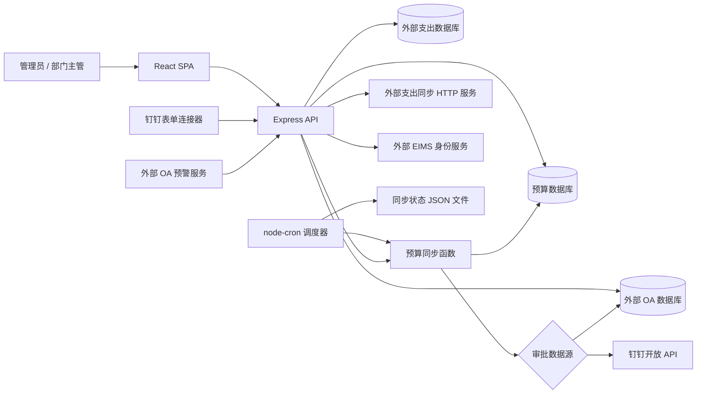

# 系统架构

## 结构和数据归属

这是一个前后端分目录的应用。后端路由处理器同时承担部分业务逻辑和 SQL 查询，`services/` 放解析、认证、组织和规则；不存在独立的 Controller/Repository 层。尤其 [routes/list.js](../../server/routes/list.js) 汇集预算读取、支出核算和报表组装，[routes/sync.js](../../server/routes/sync.js) 同时导出同步函数供调度器和脚本调用。

箭头表示调用或读取方向，外部库和外部服务并非本仓库实现。钉钉数据源切换见 [services/dingtalk.js](../../server/services/dingtalk.js)，手动支出代理见 [routes/sync.js](../../server/routes/sync.js)，跨库读取见 [routes/list.js](../../server/routes/list.js)。

## 请求处理链

`dotenv/必需配置校验` → CORS → JSON 解析（2 MB）→ `/api/` 限流 → `loadSession` → 可选 API Key 检查 → 路由级登录/角色校验 → SQL/外部调用 → JSON 或重定向。全局错误处理在生产模式隐藏错误细节，但各路由还存在自己的错误分支。

证据：[server/index.js](../../server/index.js)、[services/auth.js](../../server/services/auth.js)。API Key 与会话的放行规则见 [authentication.md](authentication.md)。

## 两类数据链路

### 预算同步

数据源枚举审批实例 → 读取原始表单 → 中西双语解析 → 解析部门稳定 ID 和组织路径 → 写预算主表/六类明细 → 同事务同步有效额度。审批状态刷新另有先更新主表状态、再用独立事务刷新额度的路径。预算记录和有效额度状态含义不同，见 [同步流程](../modules/synchronization/workflow.md)。

### 报表读取

预算 SQL 按部门和月份选最新有效候选记录 → 读取外部付款事件/完成态/部门拆分 → 在后端裁剪权限范围 → 核算支出 → 应用历史部门投影和共享预算规则 → 返回页面和 Excel 共用数据。浏览器使用 `xlsxReport.js` 的转换函数进行图表和导出加工。

证据：[routes/list.js](../../server/routes/list.js) 的 `buildBudgetWhere`、`fetchApprovalExpenseDetails`、`scopeExpenseDetailsForUser`、`attachExpenseAmounts`；[xlsxReport.js](../../client/src/utils/xlsxReport.js)。

## 事务、缓存和进程状态

| 机制 | 当前实现及限制 |
| --- | --- |
| 预算写入 | `insertRecord` / `updateRecord` 使用同一 pg Pool Client 的 BEGIN/COMMIT/ROLLBACK，明细删除重建和额度同步在事务内 |
| 状态刷新 | `updateExistingBudgetStatus` 直接更新主表，`refreshEffectiveBudgetQuota` 再开事务；两者不是一次原子提交 |
| 有效额度 | `synchronizeEffectiveBudgetQuota` 接收调用方 Client；调用方负责事务，额度按企业+实例 upsert，科目明细重建 |
| 报表查询 | `/list/report` 通过专用 Client 串行查询预算，未开启统一读事务；跨库数据不具有同一快照保证 |
| 支出缓存 | 汇总和拆分缓存默认 60 秒，存于进程内；汇总键包含日期、角色、部门，避免不同权限用户共用裁剪结果 |
| 表结构兼容 | 预算列集合缓存和支出表/列能力检测；具体兼容范围由 SQL 决定，不能视为任意旧 schema 都受支持 |
| 调度 | 进程内 `isRunning` 防止定时任务重叠，JSON 文件记录窗口和 pending；不是分布式锁，HTTP 手动路径未共用锁 |
| SSO | state/PKCE 事务存于内存 Map，10 分钟有效、消费一次；进程重启或多实例路由切换会影响回调 |
| 容错 | 钉钉 HTTP 具有超时、指数退避、熔断；不代表数据库查询、SSO、手动支出代理都具有同样的容错 |

证据：[sync.js](../../server/routes/sync.js)、[scheduler.js](../../server/services/scheduler.js)、[effective-budget-quota.js](../../server/services/effective-budget-quota.js)、[list.js](../../server/routes/list.js)、[eims-sso.js](../../server/services/eims-sso.js)、[resilience.js](../../server/utils/resilience.js)。

## 变更影响路径

部门或金额规则通常同时影响列表、详情、报表、Excel 和预警。修改时沿模块 [代码映射](../modules/expense-reporting/code-map.md) 核对前后端镜像规则、权限裁剪和外部写入方；不要把历史报表投影用于重写审批原始数据。部署进程数、数据库 schema 和真实外部服务可用性待验证。

## 公共能力及跨模块影响

| 现有实现 | 当前使用范围 / 修改前核对 |
| --- | --- |
| [DateFilter](../../client/src/components/DateFilter.jsx)、[ChangePasswordModal](../../client/src/components/ChangePasswordModal.jsx) | 列表与活动报表页面共用；日期值、回调、错误和新增翻译要同时核对两端页面 |
| [API 客户端](../../client/src/api/index.js) | 会话、统一 baseURL/超时、列表兼容、报表和同步调用；不要在新页面重复创建另一套鉴权请求 |
| [xlsxReport](../../client/src/utils/xlsxReport.js)、[chartHelpers](../../client/src/utils/chartHelpers.js) | 活动报表与列表导出复用转换；Excel 又有独立聚合分支，不能仅因共用输入就认定口径一致 |
| [部门身份](../../client/src/utils/departmentIdentity.js)、[UTC 工具](../../client/src/utils/utcDate.js) | 列表、图表、导出共用；变更需覆盖无 ID 历史记录、共享归集及月界 |
| [auth 服务](../../server/services/auth.js) | 会话、角色和部门范围；列表/报表/同步/配置均依赖；前端身份匹配不是权限替代品 |
| [department-tree](../../server/services/department-tree.js)、[额度服务](../../server/services/effective-budget-quota.js) | 同步、配置中心、回填和组织重核复用；变更需检查历史路径与当前树的差别 |
| [完成态策略](../../server/utils/completed-expense-policy.js)、[共享预算](../../server/services/yw-tech-shared-budget.js) | 支出核算与报表读模型；同时核对前端 departmentIdentity、chartHelpers、xlsxReport 对返回归集字段的处理 |
| [resilience](../../server/utils/resilience.js)、[表名校验](../../server/utils/db.js) | 现有重试/熔断及动态表白名单；不能推断所有外部调用都已使用这些工具 |

调用证据：[BudgetList](../../client/src/pages/BudgetList.jsx)、[活动报表](../../client/src/pages/VisualReportEchartsStyle.jsx)、[list 路由](../../server/routes/list.js)、[sync 路由](../../server/routes/sync.js)。其他历史报表或相似组件必须先查 import，不能凭文件名当成活动实现。翻译能力目前缺失，新增入口见 [国际化](internationalization.md)。

## 性能、恢复与可观测性

- 报表返回用于浏览器聚合/导出的整批数据，审批节点为可选扩展；列表分页不能证明报表也有等量限制。旧列表 404 回退请求 pageSize=100000 后在浏览器合并，数据增长会影响网络与内存。依据：[API 客户端](../../client/src/api/index.js)、[报表路由](../../server/routes/list.js)。
- 同步按实例顺序读取/写入，明细和额度科目逐行插入；不要描述为一次批量 SQL。报表兼容查询、跨库连接和缓存之外的查询开销应结合实际数据测量；本次没有执行 EXPLAIN、压测或数据库访问。依据：[sync.js](../../server/routes/sync.js)、[effective-budget-quota.js](../../server/services/effective-budget-quota.js)。
- 本地唯一约束和事务防止部分重复/半写入，但不提供跨系统恰好一次保证；调度状态直接写 JSON，进程失败恢复、并发覆盖和有限回补见 [同步流程](../modules/synchronization/workflow.md)。
- 日志以 console 为主；[预算库查询](../../server/db/index.js) 记录 SQL 片段、耗时和行数，[启动入口](../../server/index.js) 记录请求方法/路径和异常。没有统一请求追踪/指标告警实现；日志保留、脱敏和告警由部署侧核验。
- 数值列使用 numeric，浏览器和服务部分运算用 Number；应按来源精度及舍入验证金额一致性。已确认的页面/Excel 分支差异见 [报表指标](../modules/expense-reporting/workflow.md#页面指标与导出差异)。

以上是代码边界，不是已经发生的性能故障或已完成的容灾验收。外部链路的超时、重试和责任统一维护在 [集成关系](integrations.md)。
