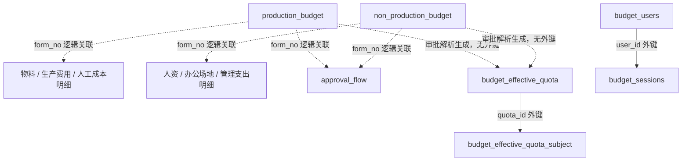
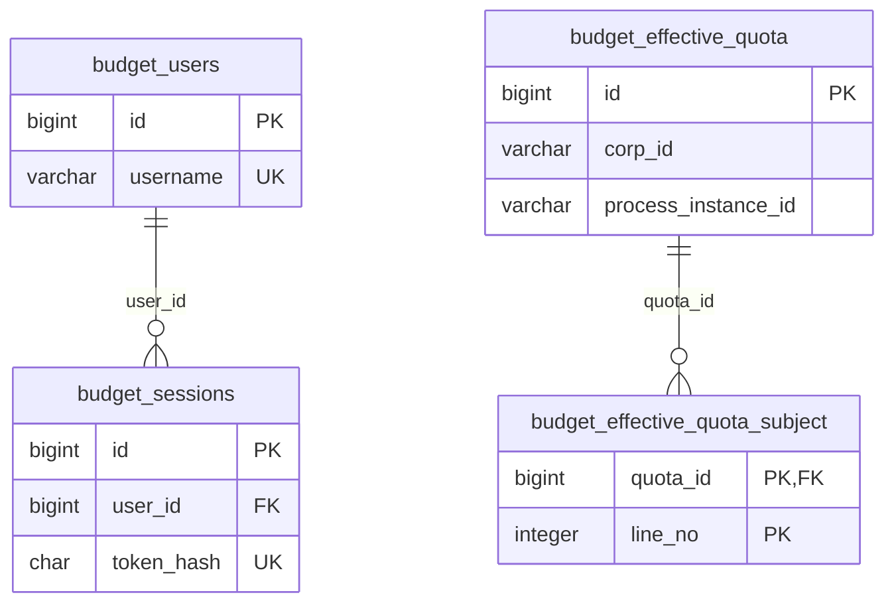

# 数据库总体结构

## 三个数据域

| 数据域 | 配置 / 默认库名 | 本项目职责 | 证据 |
| --- | --- | --- | --- |
| 预算库 | `PG*`；库名由 `PGDATABASE` 必填指定，已有说明采用 `budget_system` | 写预算申请、额度、账号和会话，读取审批流程记录 | [db/index.js](../../server/db/index.js)、[public.sql](../../public.sql)、[auth.sql](../../auth.sql) |
| OA 库 | `OA_DB_*`，默认 `dingtalk_oa` | 读取审批实例、任务、流程模板、用户快照、部门树 | [dingtalk.js](../../server/services/dingtalk.js)、[department-tree.js](../../server/services/department-tree.js)、[approval-efficiency.js](../../server/services/approval-efficiency.js) |
| 支出库 | `APPROVAL_DB_DATABASE` → `DINGTALK_APPROVAL_DATABASE` → `dingtalk_approval` | 读取运营、采购、月结、付款事件和部门拆分；DDL 由外部支出项目维护 | [list.js](../../server/routes/list.js) |

支出读取实际复用 `PGHOST/PGPORT/PGUSER/PGPASSWORD`，不是独立完整的 `APPROVAL_DB_*` 连接。OA 审批效率连接有额外回退规则，见 [部署](deployment.md)。未连接线上数据库，本页描述仓库定义和代码使用。

## 本地表清单

`public.sql` 定义 11 张表，`auth.sql` 另定义 2 张表，共 13 张；旧 README 的“8 张表”不完整。

| 表 | 业务用途 | 关键关联 | 详细字典 |
| --- | --- | --- | --- |
| `production_budget` | 生产预算主表 | `form_no` 唯一；`process_instance_id`、部门和月份 | [预算数据](../modules/budget-applications/database.md) |
| `non_production_budget` | 非生产预算主表 | 同上 | 同上 |
| `budget_material` | 物料预算明细 | `form_no` 逻辑关联主表 | 同上 |
| `budget_production` | 生产费用预算明细 | 同上 | 同上 |
| `budget_labor` | 人工成本预算明细 | 同上 | 同上 |
| `budget_hr` | 人资预算明细 | `form_no` 逻辑关联非生产主表 | 同上 |
| `budget_office` | 办公场地预算明细 | 同上 | 同上 |
| `budget_operation` | 管理支出预算明细 | 同上 | 同上 |
| `approval_flow` | 本地审批节点记录 | `form_no` / `process_instance_id`，无主表外键 | [预算数据](../modules/budget-applications/database.md) |
| `budget_effective_quota` | 已通过预算额度台账 | 唯一 `(corp_id, process_instance_id)` | [额度数据](../modules/effective-quota/database.md) |
| `budget_effective_quota_subject` | 有效额度科目行 | PK `(quota_id,line_no)`、外键级联删除 | 同上 |
| `budget_users` | 账号、角色、部门范围 | `username` 唯一，角色/部门 CHECK | [认证数据](../modules/authentication/database.md) |
| `budget_sessions` | 会话哈希和有效期 | `token_hash` 唯一，`user_id` 外键 | 同上 |

## 模型约定和数据完整性

核心字段、空值/精度及状态语义见 [数据字典](data-dictionary.md)，细表字段继续在模块文档维护。下图仅表示仓库 DDL 中真实存在的外键；上图虚线均为应用逻辑关系。

额度的唯一键是 `(corp_id,process_instance_id)`，科目主键是 `(quota_id,line_no)`；图中列只是关系摘要，不替代 DDL。用户角色及主管部门有 CHECK，预算/额度状态没有统一枚举 CHECK；不能仅依赖数据库自动验证状态流转。

- 金额用 PostgreSQL `numeric`；预算主表/明细通常为 `(14,2)`，额度为 `(18,2)`，汇率为 `(18,6)`。应用端部分计算使用 JS Number 并四舍五入，不应假定全链路为十进制定点运算。
- 预算月份为 `varchar(7)` 的 `YYYY-MM`；申请日期为 `date`；原预算 `create_time` 为不带时区 `timestamp`，额度及会话时间为 `timestamptz`。支出记账按 UTC，连接器缺省月份按上海时区；详见模块流程。
- 部门 ID 使用字符串，路径使用 JSONB；名称是展示快照。无 ID 的历史数据不能作为主管权限匹配依据。
- 六类预算明细及审批记录没有主表外键；主表/明细一致性依赖同步事务。主表的 `form_no` 唯一约束并不包含企业 ID，尚不是完整跨企业模型。
- 主表解析固定写 `tenant_id='default'`，未见统一租户过滤；有效额度的企业复合键只解决该台账的来源唯一性。
- 额度表无独立余额列；列表、执行率和预警仍通过预算申请与实际支出计算。不得把存在额度台账理解为所有读取都已切换到它。

证据：[public.sql](../../public.sql)、[auth.sql](../../auth.sql)、[parser.js](../../server/services/parser.js)、[effective-budget-quota.js](../../server/services/effective-budget-quota.js)、[dingtalk.js](../../server/routes/dingtalk.js)。

## SQL 脚本的作用和边界

| 文件 | 作用 | 使用限制 |
| --- | --- | --- |
| [public.sql](../../public.sql) | 本地业务表初始化 | 含 DROP TABLE/SEQUENCE CASCADE，是重建脚本，不可对已有数据直接重跑 |
| [migrate.sql](../../migrate.sql) | 既有表字段补充、兼容修正、索引和额度表 | 虽大量使用 IF EXISTS，仍删除旧列和旧表并修正数据，不能把“幂等”视为无损 |
| [auth.sql](../../auth.sql) | 用户、会话、约束、索引 | 建表脚本，不含预置账号 |
| [sql/ensure-effective-budget-quota.sql](../../sql/ensure-effective-budget-quota.sql) | 额度及科目表增量 schema | 本项目额度表的专项脚本，未修改外部库 |

初始化主表 `dept_name` 为 `varchar(255) NOT NULL`；迁移会转为 `text`，未见移除 NOT NULL。同步的服务主体无法解析时会提供空名称，这与该约束可能冲突。真实目标库约束待验证。

当前没有版本化迁移框架或配套的统一回滚脚本。DDL 中月份、部门/月、form_no、额度期间/组织/科目、会话过期与用户索引均须结合实际查询评估；索引存在不等于实际执行计划已验证。新增字段应同时评估精度、默认值、空值、唯一键及历史数据，再由获准的变更任务制定迁移/回滚方案，本次不执行 SQL。

## 外部 schema 验证范围

外部字段仅根据 SELECT、JOIN 和能力检测整理，见 [支出数据](../modules/expense-reporting/database.md)、[额度数据](../modules/effective-quota/database.md)。这些表的完整主键、索引、外键、迁移历史与写入规则不在本仓库；需由所属项目或授权后的数据库检查验证。`approval_flow` 的写入方也待确认。
