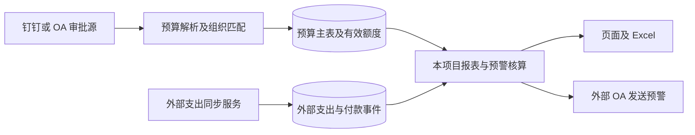

# 系统集成关系

验证状态：2026-10-19 已通过仓库调用代码静态确认；未访问钉钉、OA、EIMS、外部支出服务或数据库。外部部署、权限配置、Schema 和调用方行为均待验证。本文维护责任边界，详细接口继续使用 [API 总览](api-overview.md) 和模块文档。

## 系统、调用方向和责任

| 调用方向 | 用途 / 协议 | 认证与责任边界 | 代码依据 |
| --- | --- | --- | --- |
| 浏览器 → 本项目 API | 预算、报表、额度、登录、手动同步；JSON/重定向 | Cookie 会话及路由角色/部门校验；浏览器可选 X-API-Key 不是保密凭据 | [客户端 API](../../client/src/api/index.js)、[路由挂载](../../server/index.js) |
| 本项目 → 钉钉开放 API | 审批实例列表、详情；dingtalk 数据源模式 | App Key/Secret 换 access token，内存缓存；原始审批维护由钉钉负责 | [dingtalk.js](../../server/services/dingtalk.js) |
| 本项目 → 外部 OA PostgreSQL | oa_db 审批源、组织树、审批效率 | 使用 OA/PG 配置的数据库账号；本项目读取，原始审批/组织快照同步由外部 OA 项目负责 | [审批数据源](../../server/services/dingtalk.js)、[组织树](../../server/services/department-tree.js)、[审批效率](../../server/services/approval-efficiency.js) |
| 本项目 → 外部支出 PostgreSQL | 运营、采购、月结、付款事件、部门拆分 | 读取现成核算依据，不执行支付；外部项目负责识别事件、拆分写入、人工确认和外部 DDL | [支出查询](../../server/routes/list.js)、[支出字典](../modules/expense-reporting/database.md) |
| 本项目 → 外部支出同步 HTTP 服务 | POST /api/sync/manual、POST /api/sync/operation-splits | 会触发外部写入；本项目入口要求管理员。出站调用代码仅显式传 timeout，未配置认证请求头，实际网关/网络鉴权待验证 | [sync.js](../../server/routes/sync.js) 的 `triggerExpenseManualSync/triggerExpenseSplitSync` |
| 钉钉连接器 → 本项目 | querySimple/query 返回预算金额/历史列表 | 全局 API_KEY 按配置启用；连接器路由没有独立 requireAuth。完整边界见 [认证](authentication.md) | [连接器路由](../../server/routes/dingtalk.js)、[参数解析](../../server/services/connector-department-query.js) |
| 外部 OA 预警服务 → 本项目 | GET /api/dingtalk/alert-budget-snapshot | 专用 X-Budget-Alert-Key；本项目只返回预计使用率快照，发送通知、接收人和通知去重由外部 OA 负责 | [预警流程](../modules/dingtalk-integration/workflow.md) |
| 浏览器 / 本项目 ↔ EIMS | Discovery、授权码＋PKCE、userinfo、单点退出 | 后端 Basic 客户端认证及 Bearer userinfo；app_user_id 绑定本地 username，本地角色/部门控制数据范围 | [EIMS 服务](../../server/services/eims-sso.js)、[认证流程](../modules/authentication/workflow.md) |

三类数据库的连接变量、回退顺序和必填项统一维护在 [运行环境](deployment.md)。不得把本地只读查询推断为数据库账号只有 SELECT 权限，也不保存任何真实凭据。

## 数据流和一致性边界

图中箭头表示业务数据方向；实际查询由本项目主动发起。普通预算插入/更新可以在一个本地事务内写主表、明细和额度，但与 OA/支出库之间没有分布式事务或统一快照。预算状态刷新还有独立提交边界，见 [架构](architecture.md#事务缓存和进程状态)。

支出处理按合格付款事件、完成态拆分、完成态兜底和月结分支防重复；本项目读取去重不证明外部写入实现了唯一约束或恰好一次处理。不能给跨系统 POST 自动增加重试并假定安全，须先核实外部幂等契约。来源业务编号、企业、事件 ID 的唯一性仍待验证。

## 超时、重试和降级

| 链路 | 当前机制 | 失败边界 |
| --- | --- | --- |
| 浏览器 JSON 请求 | 默认30秒，报表180秒，同步600秒 | 页面提示错误；浏览器超时不保证后端/外部操作已经取消 |
| 钉钉 HTTP | 默认15秒；retry 指数退避，默认最多3次重试，token/list/detail 有各自进程内熔断器 | 原始 API HTTP 成功与业务 errcode 需分别判断；新旧列表单模式错误可能被吸收后返回空集合，见同步模块 |
| 外部支出同步 HTTP | 默认180秒；本地调用未复用 retry/熔断工具 | 普通同步错误封装到 expenseSync；专项拆分错误进入路由失败响应；未配置 URL 时两条路径行为不同 |
| OA / 支出数据库 | pg 连接超时与连接池按各服务配置 | 连接超时不等于 SQL statement_timeout；当前不能宣称所有查询有统一执行时限 |
| 报表支出及审批效率 | 实际支出汇总、审批效率存在局部 warnings 降级 | 待审批支出查询异常会使整个报表失败；部分金额返回零/空时不能等同真实无支出 |
| EIMS | state/PKCE 事务10分钟、一次性消费；Discovery 缓存在进程内 | Discovery、换令牌、userinfo 的 axios 调用未显式设置 timeout/retry；state TTL 不能代替 HTTP 请求超时 |
| 额度组织选项 | 优先 OA 当前组织树 | OA 查询失败回退当前额度台账的组织选项，可能不完整；接口没有单独返回来源警告 |

依据：[客户端 API](../../client/src/api/index.js)、[钉钉数据源](../../server/services/dingtalk.js)、[容错工具](../../server/utils/resilience.js)、[同步路由](../../server/routes/sync.js)、[报表路由](../../server/routes/list.js)、[EIMS](../../server/services/eims-sso.js)、[额度选项](../../server/routes/quota-configurations.js)。反向代理示例超时与长请求的差异见 [部署](deployment.md)。

## 同步恢复、审计和契约变更

- 增量窗口、pending、有限回补和状态 JSON 由 [scheduler.js](../../server/services/scheduler.js) 维护；单实例错误日志不等于可靠失败队列。没有本地跨系统补偿表、分布式锁或消息队列实现。
- 常规预算写入事务、来源唯一键和额度 upsert 提供局部一致性；手动/定时并发、旧事件覆盖新状态等情况没有被统一版本检查完全解决。具体事实与验证建议见 [同步流程](../modules/synchronization/workflow.md)。
- 审批原始证据在外部 OA/钉钉；本地额度有来源编号、审批状态/时间、科目 source_data 和有效/失效时间，但不是逐次变更的完整审计流水。支出证据读取自外部事件，不在知识库复制实际业务记录。
- 日志主要为 console 与 PM2 收集，没有统一请求关联 ID 或监控指标体系；部分日志包含实例/业务编号和错误堆栈，应由部署侧控制访问和保留。健康检查仅证明进程响应。
- 改集成字段先定位生产方、消费方、认证、时间/金额/部门含义，兼容旧字段及来源规则后再联调。不能只修改本项目 SQL 或 UI 就宣称跨系统功能完成。

待验证：外部支出服务鉴权与幂等、OA/支出真实 Schema、付款授权来源的一致性、EIMS issuer/用户绑定与安全校验、预警消息接收人及去重、线上超时/失败恢复。统一问题索引见 [知识库入口](README.md#待验证及已知边界)。
