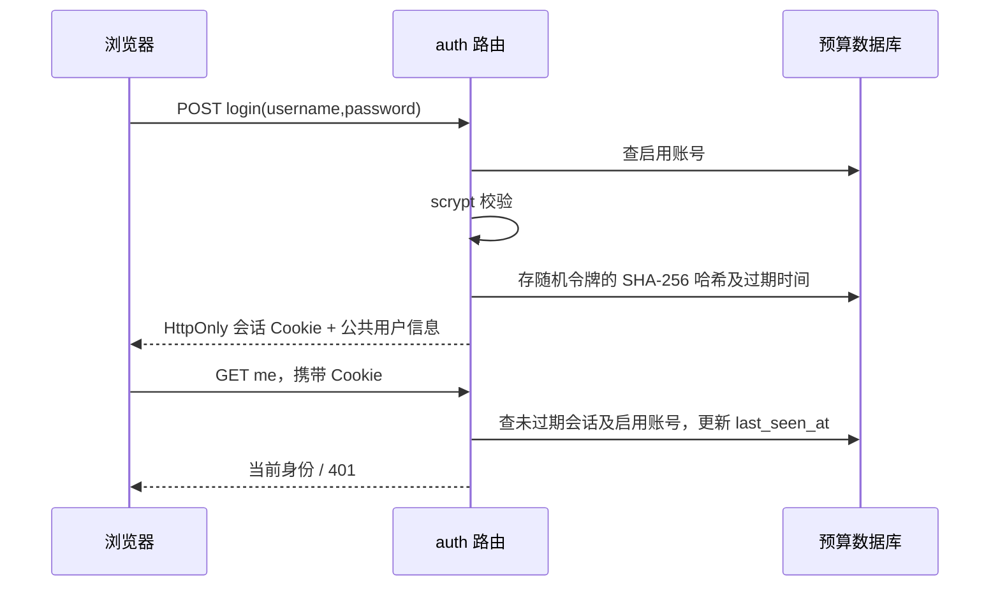

# 登录与权限：流程

## 本地登录与会话

`loadSession` 在每个 `/api/` 请求读取 Cookie，用户必须 active=true 且会话未过期。数据库异常时记录警告并不设置身份，受保护接口随后按未登录处理。Cookie 保留随机原令牌，表内只存哈希；角色/部门信息每次来自本地用户表。

依据：[auth.js](../../../server/services/auth.js)、[routes/auth.js](../../../server/routes/auth.js)。会话默认 7 天，没有滑动延长逻辑；更新 last_seen_at 不更新 expires_at。表中允许同用户多个会话，未见自动清理过期行的调度。

## 改密与退出

改密校验非空、长度、确认一致、新旧不同，再读取当前启用用户的 password_hash 验证旧密码；更新哈希及 updated_at。不会撤销已建立的其他会话或强制退出当前会话。

退出删除当前 Cookie 对应 token_hash，清会话与 SSO 标记；不实现“退出所有设备”。SSO 标记只用于选择退出流程，不决定角色或部门权限。

方法：[auth.js](../../../server/services/auth.js) 的 `changePassword/deleteSession/setEimsSessionMarker`；前端 [App.jsx](../../../client/src/App.jsx) 的 `handleLogout`。

## EIMS 登录

1. 浏览器进入 `/api/auth/eims/start`；服务读取 EIMS 配置和 `{issuer}/oauth/.well-known/openid-configuration`，验证 Discovery issuer 和端点 URL。
2. 内存 Map 保存随机 state、nonce、PKCE verifier，10 分钟有效；授权 URL 携 client_id、redirect_uri、scope、state、nonce、S256 challenge。
3. 回调先消费 state，一次性且检查过期；有 error 或缺 code 跳登录页。
4. 后端用 Basic 客户端认证、授权码和 verifier 换 access_token，再以 Bearer 调 userinfo。
5. userinfo.app_user_id 精确匹配本地启用 username；未绑定不自动建用户，有绑定则创建与本地登录同样的会话并设 SSO 标记，跳前端 CORS_ORIGIN。

来源：[eims-sso.js](../../../server/services/eims-sso.js)、[routes/auth.js](../../../server/routes/auth.js)。本地角色/部门控制仍有效，不向 EIMS 提交预算用户密码。

## 当前 SSO 边界

- 虽构造 nonce，当前回调没有读取/验证 ID Token 签名、claims 或 nonce，也没有比较 EIMS 角色；这里只能确认 state、PKCE、userinfo 和本地绑定链路。
- Discovery 缓存在进程内，未设置刷新 TTL；登录/退出事务也存内存，没有跨进程共享或绑定浏览器事务 Cookie。
- 配置允许 http/https URL；生产 HTTPS 由部署保证，不是协议校验自动强制。真实 issuer、回调登记和用户映射待 EIMS 联调验证。
- 多实例/重启会丢失未完成 state；直接把 PM2 改 cluster 并不能保证回调继续工作。

## 单点退出和错误跳转

已登录用户请求 `/eims/logout`，后端保存退出 state、生成 end_session_endpoint URL，再删除本地会话并返回 logoutUrl。浏览器跳转，回调消费退出 state 后跳前端。若该接口失败，App 尝试本地退出。错误通过前端 URL 的 sso_error 参数表示，包括 unavailable、invalid_state、denied、account_not_bound、failed、invalid_logout_state。

这些是当前流程事实，不代表外部 EIMS 会话已在所有故障情况下退出。本次未联系 EIMS 或创建登录会话。
