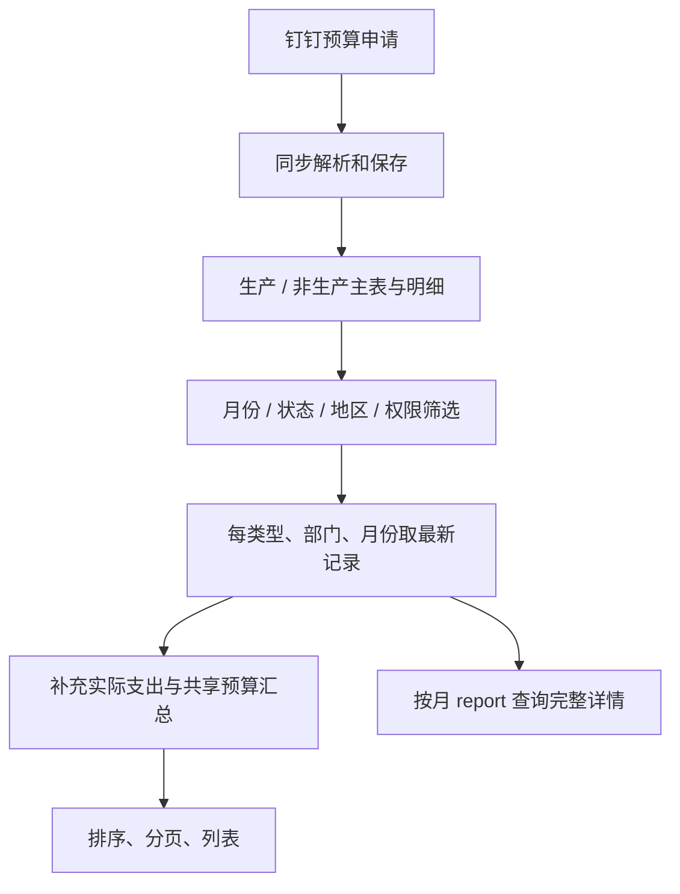

# 预算申请与查询：流程

## 来源和状态

来源解析和状态入库见 [同步流程](../synchronization/workflow.md)。主表展示状态通常为审批中、已通过、已驳回、已撤销；状态由外部审批驱动，不存在本地审批状态修改 API。特殊 `TERMINATED + agree + 完成时间` 可被额度同步认可，但主表展示仍可能是已撤销；不要用展示文字替代额度生效判断。

## 查询次序

1. `buildBudgetWhere` 把日期规范到月份，使用 `budget_month`，为空则回退 `declaration_month`。
2. 排除含撤销/驳回/终止等关键词的状态；若调用方传 `status`，再叠加等值条件，而非放开无效状态过滤。
3. 正提交金额候选要求中国执行地区；金额取主表金额列最大值，非正候选允许保留。中国识别含 China、中国或精确 CN。
4. 附加部门 ID/路径权限；CTE 要求对应六类明细至少一类存在。
5. `ROW_NUMBER` 按部门键和月份分区，`create_time DESC NULLS LAST,id DESC` 取第一条。稳定 ID 优先；无 ID 时包含表单号的历史键避免将不同单据直接合并。
6. 使用 LATERAL 汇集预算明细和类别金额，再应用部门展示/历史投影，附加支出并合并共享预算。
7. 三个列表接口实际先取得候选、核算后按数组 slice 分页；`/all` 合并两类后分页。不存在简单数据库 LIMIT 即可替换的等价保证。

证据：[list.js](../../../server/routes/list.js) 的 `buildBudgetWhere`、`deptPartitionExprFor`、`productionBudgetCte`、`nonProductionBudgetCte`、`attachExpenseAmounts`、三个列表路由。

## 详情和导出

`handleOpenDetail` 先展示当前行，再以该行预算月请求 `/list/report?includeApproved=1`；优先按 `form_no + department_identity_key` 匹配，再回退 form_no 或原行。失败时保留原行，不证明完整详情已加载。

导出按页面选择范围获取 report；`filterReportDataForExport` 根据当前页签进一步限定导出部门，`createBudgetReportWorkbook` 在浏览器生成 Excel。详情支出分类、共享预算和导出口径见 [报表流程](../expense-reporting/workflow.md)。

证据：[BudgetList.jsx](../../../client/src/pages/BudgetList.jsx)、[reportExportScope.js](../../../client/src/utils/reportExportScope.js)。

## 统计和时间边界

`/stats` 的 total 使用上述最新候选计数；today 按主表 `DATE(create_time)` 计数，不按当前页面日期范围筛选，也没有同一部门/月的去重步骤。当前日期来自 `new Date().toISOString()`，原表创建时间是无时区 timestamp，解析又可能从业务编号提取；真实数据库时区和跨日统计应在目标环境验证。

预算申请月份/时间不能改为实际支出的审批完成月份。现有时间来源见 [parser.js](../../../server/services/parser.js) 的 `parseCreateTime`、[list.js](../../../server/routes/list.js) 的 `/stats`。
