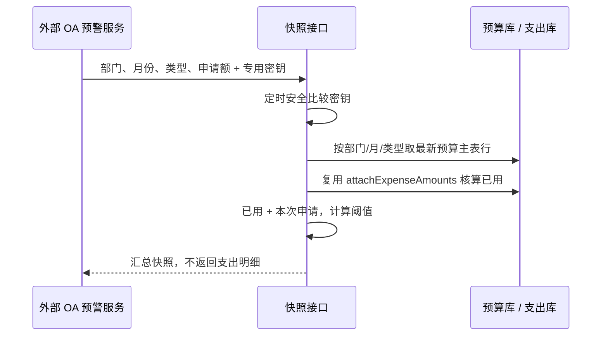

# 钉钉查询与预警集成：流程

## 简化查询

1. `resolveTableName` 判断预算类型；无类型返回 budgetAmount='0'。
2. 传 formNo 时优先按业务编号读取，不再应用月份/部门参数；有会话时仍附加用户部门范围。
3. 无 formNo 时解析部门 ID 或完整名称。缺部门返回零；共享预算子部门在 2026-07 起可映射到配置父部门。
4. 时间参考依次为 startDate、endDate、time/month/date、中文时间/申请日期；都无则以上海时区当天所在月为准。
5. 优先按参考自然月筛选，月份字段回退 budget_month → declaration_month → 创建时间的上海时区日期，再取 create_time 最新的一条。
6. 生产返回 monthly_budget_amount，非生产返回 budget_amount，均转换为字符串。

`startDate/endDate` 在该简化接口通常以参考月份为主，不是像旧 query 那样任意起止时间区间。当前没有过滤无效审批状态、执行地区或预算明细存在性，也不等同列表候选的去重 SQL。

依据：[dingtalk.js](../../../server/routes/dingtalk.js) 的 `/querySimple`、`getMonthRange/budgetMonthDateSql`。

## 旧查询

必须至少传部门或起止日期之一；默认类型为生产。部门用相同 ID/名称过滤，日期用主表 create_time 的日首/日末边界，不用预算月份；按创建时间降序最多 50 条，不提供分页 total 全量计数。

有会话时施加部门范围，无会话时范围辅助函数为 TRUE。启用全局 API_KEY 才有密钥门槛，这一入口边界不可因前端登录规则而忽略。证据：[dingtalk.js](../../../server/routes/dingtalk.js)、[index.js](../../../server/index.js)、[auth.js](../../../server/services/auth.js)。

## 预算预警快照

找不到预算仍返回 missing_budget 和本次申请预计金额；非正预算不计算利用率。申请金额须非负数字，月份规范化为 YYYY-MM。`findAlertBudgetRow` 只按部门/月/类型取最新，排序 create_time DESC,id DESC；没有状态或额度 effective 条件。

| 条件 | alertLevel |
| --- | --- |
| 无预算或预算 <=0 | missing_budget |
| projectedAmount > budgetAmount | over_budget |
| projectedAmount >= 90% budgetAmount | warning_90 |
| 其他正预算 | normal |

恰好 100% 为 warning_90，只有超过才 over_budget。快照无数据库写入；实际通知和 90%/超额接收人、去重、触发时机由外部 OA 项目决定。

## 待验证边界

预警已用金额沿用 `attachExpenseAmounts`，其外部支出失败可能回退为空，快照没有另设完整数据标志；预算来源状态、同名回退、跨企业编号、源库可用性和外部通知必须在联调时核验。有效额度尚未替代这条主表读取链路，不在初始化任务中变更业务。

方法证据：[dingtalk.js](../../../server/routes/dingtalk.js) 的 `findAlertBudgetRow/resolveAlertBudgetSnapshot/calculateBudgetAlertSnapshot`、[list.js](../../../server/routes/list.js) 的 `attachExpenseAmounts`。
