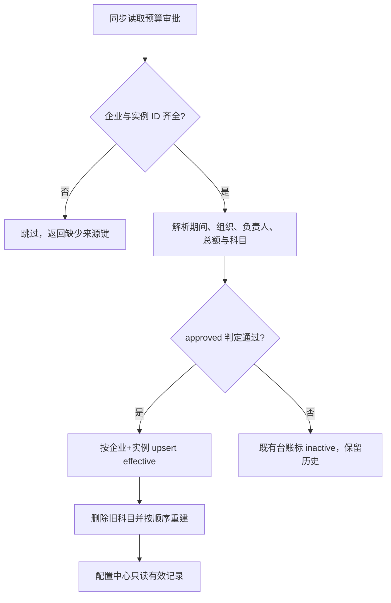

# 有效预算额度与配置中心：流程

## 生效与失效

`approved` 由调用方提供；预算同步兼容 COMPLETED+agree 和具完成时间的 TERMINATED+agree，同时排除取消动作及拒绝任务。服务本身不重新推断所有审批状态。来源键缺少时返回 synchronized=false，不抛数据库错误。

证据：[effective-budget-quota.js](../../../server/services/effective-budget-quota.js)、[sync.js](../../../server/routes/sync.js) 的 `getApprovalState` 和事务调用。

## 科目、金额和负责人

六类预算明细转换为 `subject_type/code/name` 行；有明细编码时 code 使用“类型:编码”，否则使用类型。名称取具体预算项目/用途或类型默认名称；该 code 不是独立统一科目主数据表。

明细按分求和，与总额差大于 0.005 标记 mismatch；总额始终取表单，不由明细替代。负责人 ID 优先预算 creator_userid/审批申请人，名称优先解析的 creator_name 再申请人快照。

方法：[effective-budget-quota.js](../../../server/services/effective-budget-quota.js) `buildEffectiveBudgetSubjects/buildEffectiveBudgetQuota`；字段解析来源 [parser.js](../../../server/services/parser.js)。总额与明细不一致的真实单据及历史标题格式待业务核验。

## 当前组织和历史重核

普通同步用部门路径或已确认历史映射生成集团、公司和部门，并设置 organization_is_current。配置选项优先读取 OA 当前树：集团直属下级为子公司，更深节点才是部门选项；同名不同 ID 不合并。OA 查询失败时回退台账组织，选项可能不完整；接口未返回独立来源标志或警告，需要结合服务日志和组织数据核实，不能仅凭响应成功判断来自当前树。

`reconcile-effective-budget-organizations.js` 读取所有额度及 OA 当前树，以企业+部门查当前节点，复用历史映射；命中更新组织字段并 current=true，未命中只标 current=false 并保留原历史字段。该脚本不负责先同步钉钉组织树，OA 组织更新属于其他项目。

证据：[department-tree.js](../../../server/services/department-tree.js)、[quota-configurations.js](../../../server/routes/quota-configurations.js)、[组织重核脚本](../../../server/scripts/reconcile-effective-budget-organizations.js)。历史未确认部门继续待确认，不新增猜测映射。

## 只读查询

页面分别加载 options 和列表；集团/公司变更清掉不再属于范围的下级选择，点击查询后按已应用条件分页。接口只读 effective 行；明细和集团/公司汇总可包含历史未确认组织，部门 rollup 额外要求 current=true、存在公司且部门不等于公司本级。公司本级额度在明细显示为“子公司本级”，不把它充当下属部门选项。

科目筛选用 EXISTS 限制相关额度，再只汇总/返回所选科目；额度总额不被筛选科目金额覆盖。来源：[quota-configuration.js](../../../server/services/quota-configuration.js)、[BudgetConfiguration.jsx](../../../client/src/pages/BudgetConfiguration.jsx)。

## 回填和故障边界

额度回填要求显式完整时间范围，逐实例检查预算和通过状态，仅写台账和科目，单据各自事务；有失败时进程非零结束，缺少来源键另计 missingSourceKey 而不保证非零。当前脚本复用审批适配器，读取 OA 还是直连钉钉由配置决定；组织路径仍通过 OA 组织服务解析。

服务与回填都需要表先存在；缺少 schema 会使写入失败。生效重写会更新 effective_at 并重建科目；此表不是每次变更都追加的完整版本事件日志。真实迁移、数据缺键和组织映射效果待验证。本次未运行 schema/回填/重核脚本。

证据：[backfill-effective-budget-quota.js](../../../server/scripts/backfill-effective-budget-quota.js)、[ensure-effective-budget-quota.js](../../../server/scripts/ensure-effective-budget-quota.js)、[effective-budget-quota.js](../../../server/services/effective-budget-quota.js)。
