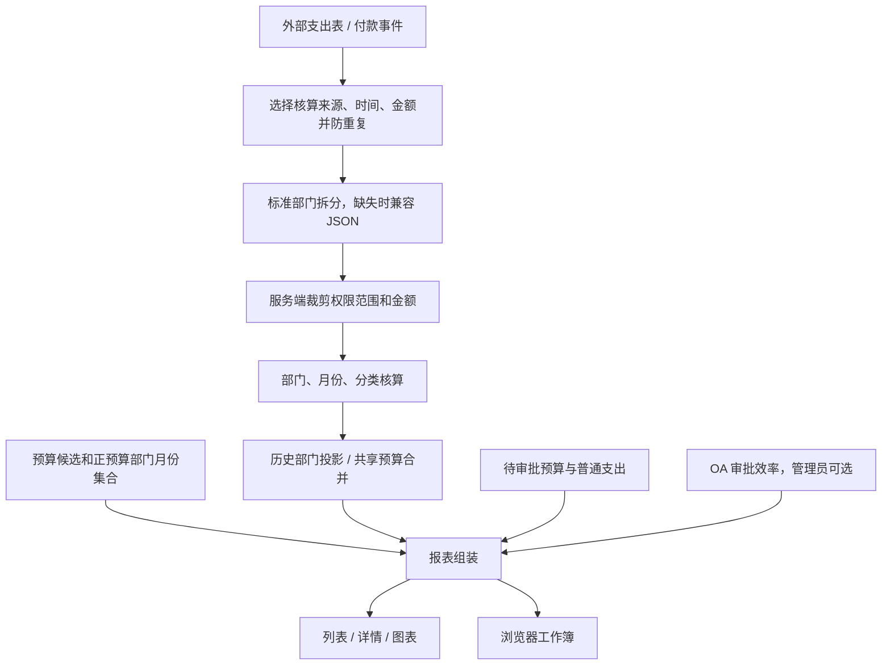

# 支出核算、报表与导出：流程

## 从数据到页面

主要实现：[list.js](../../../server/routes/list.js) 的 `fetchApprovalExpenseDetails`、`fetchApprovedExpenseSummaryFresh`、`scopeExpenseDetailsForUser`、`attachExpenseAmounts` 和 `/report`。

## 付款事件、完成态和去重

1. 只读 confirmed 事件，认可两组来源：`authorized-comment-v1` + `comment_explicit_amount/fully_deducted` + 授权用户；或 `manual-confirmed-v1` + `manual_confirmed`。授权用户由 `DINGTALK_PAYMENT_EVENT_USER_IDS` 或代码默认列表确定，不用非授权评论替代付款证据。
2. 运营单存在 `approval_expense_dept_split` 行或非空历史拆分 JSON 时，走完成态部门拆分，不进入整单付款事件/整单完成态兜底，避免专项与通用明细同时累计。
3. 无拆分的运营/采购存在任何合格 confirmed 事件时，不再按整单完成金额兜底；排除不局限于当前报表日期，因此旧付款也能阻止本月重复兜底。
4. 完成态要求 `approval_completed_at`、COMPLETED、最终同意。结果优先 raw_data.result，空时回退 flowResult/flow_result。预算的 TERMINATED 兼容规则不适用。
5. 月结仅通过匹配业务编号、expense_kind=monthly_settlement 的合格付款事件入账，独立分类；不再依据所关联采购单补算一份。
6. 明细以来源、支出类型、业务编号、付款事件/实例 ID、月份等键去重。部分付款可产生多期明细，金额取事件本位币金额，月份为 accounting_at/paid_at UTC 月。

证据：[list.js](../../../server/routes/list.js) 的 SQL 条件及 `isAccountableExpense`；[completed-expense-policy.js](../../../server/utils/completed-expense-policy.js)。全额抵扣事件金额为零，保留处理明细而不增执行金额，规则维护在 [既有专题](../../fully-deducted-payment-rule.md)。

## 拆分、权限和金额

标准拆分行优先，标准行缺失时读取历史 JSON；这些读取不会回填原数据。`scopeExpenseDetailsForUser` 按真实 ID/路径过滤可见拆分，计算可见拆分金额；如果整单直属部门可见，还加未拆分余额，否则清父部门元数据。历史 JSON、其他部门名和整单金额不能在裁剪前泄露。

核算把各专项拆分分配到明细部门；未分配的正余额可归整单部门。普通运营+采购包含在 management，薪酬/备用金/办公场地/个税/月结等再各计一次；直接将所有展示列相加会重复。金额及舍入方法核对 `attachExpenseAmounts` 和 `summarizeApprovedDetails`，不要仅修改前端合计。

存在正预算的部门/月，其普通支出要求中国执行地区；无正预算支出允许进入汇总。月结不套该限制。`buildBudgetedDepartmentMonthSet` 读取候选时可关闭预算地区过滤，以识别真实存在正预算的范围。

证据：[list.js](../../../server/routes/list.js) 的拆分和权限函数、`shouldIncludeDepartmentExpense`、`filterExpenseDetailsForReport`。

## 历史组织和共享预算

2026-07 起报表优先稳定 ID；2026-07 的专门部门投影及精确业务编号覆盖仅改变 reporting 字段，不改数据库原部门。共享预算配置包含悦为智能、拉丁购两组，从 2026-07 起按父预算汇总指定子部门支出，父预算只累计一次。

来源：[july-department-reporting-overlay.js](../../../server/services/july-department-reporting-overlay.js)、[yw-tech-shared-budget.js](../../../server/services/yw-tech-shared-budget.js)。前端基于响应 identity/shared 字段处理图表和导出，见 [departmentIdentity.js](../../../client/src/utils/departmentIdentity.js)、[chartHelpers.js](../../../client/src/utils/chartHelpers.js)、[xlsxReport.js](../../../client/src/utils/xlsxReport.js)。新增历史映射须精确匹配并覆盖多端验证。

## 待审批和审批效率

待审批预算按申请日期/创建日期读取，不沿用预算月份最新候选；授权人员已支付/部分支付/已全额抵扣意见可将其排除。普通待审批支出按 request_date、进行中状态、地区及付款证据读取，结果使用真实部门权限过滤。

审批效率从 OA 已启用且未删除流程、未删除实例查询；范围按实例 create_time。完成耗时以具有 finish_time 和有效起止时间的实例统计；进行中节点计算至查询时刻，超过 24 小时才超时，无起始时间或负耗时不进入耗时指标。当前代码按 finish_time 而非必须 COMPLETED 状态判断完成耗时分组。节点 Excel 显示北京时间到秒，支出仍按 UTC。

证据：[list.js](../../../server/routes/list.js) 的 `fetchPendingBudgetRows/fetchPendingExpenseRows`、[approval-efficiency.js](../../../server/services/approval-efficiency.js)、[utcDate.js](../../../client/src/utils/utcDate.js)。

## 故障和验证边界

支出实际汇总捕获外部库失败并返回 warnings，列表附加支出可能为空/零；不能把成功显示的零认定为真实零支出。审批效率查询失败不会中断预算报表，返回警告。

但 `/report` 还串行调用 `fetchPendingExpenseRows`，该外部支出库连接/查询异常未在内层降级，会进入整个 report 的 500 分支。已有文档的“预算报表继续返回”只可确认适用于 OA 审批效率失败，不能扩大为所有外部库失败均可用。缓存默认 60 秒，细节见 [架构](../../knowledge/architecture.md)。

## 页面指标与导出差异

活动入口为 [VisualReportEchartsStyle.jsx](../../../client/src/pages/VisualReportEchartsStyle.jsx)。它调用 `/api/list/report`，再通过 [xlsxReport.js](../../../client/src/utils/xlsxReport.js) 展开预算明细、生成部门/月执行行，通过 [chartHelpers.js](../../../client/src/utils/chartHelpers.js) 汇总图表；这些是读模型计算，不是数据库里的指标字段。

| 指标 | 当前计算依据 |
| --- | --- |
| 生产/非生产预算金额 | 展开明细的 requestAmount/amount 求和；共享预算子部门不重复计预算。不能直接视为有效额度台账总额 |
| 生产/非生产数量 | 展开后的 productionRows/operationRows.length，是预算明细行数，不是去重审批单数 |
| 已执行金额 | 部门/月 executionRows.totalApproved 求和，包括符合规则的无预算支出；已提交预算支出另用 budgetSubmittedApprovedTotal |
| 整体执行率 | 已执行金额 ÷（生产预算金额＋非生产预算金额），显示一位小数百分比；分母非正时为0%，不是平均各部门执行率 |
| 剩余金额 | executionRows.remainingBudget 汇总；与状态图中扣除待审批金额后的“未执行”属于不同指标 |
| 执行状态图 | 部门汇总预算、已执行及普通待审批支出；未执行=max(0,预算－已执行－审批中)，按预算降序取前10项 |

具体入口为 `buildSummaryStats/buildExecutionStatus` 及 `buildExecutionRows`。预算候选的审批状态、地区和月份限制仍以 [预算流程](../budget-applications/workflow.md) 及本页后端核算规则为准；图表展示排名不能当作全部部门清单，真实部门编码来源见 [核心字典](../../knowledge/data-dictionary.md#部门组织和租户)。

**已静态确认的差异**：页面 `buildExecutionStatus` 只接收 pendingExpenses，并筛选 operation/purchase/monthly_settlement；Excel `createBudgetReportWorkbook` 的执行状态汇总同时遍历 pendingBudgetRecords 与 pendingOrdinaryExpenseRecords，把待审批预算也加到 inProgress。若该预算 form_no 不在已返回预算集合中，Excel 还把金额加到 totalBudget。因此，同一次报表数据也可能出现“审批中”“预算总额”“未执行”及前10排名不一致。

这项差异的分支依据已确认，真实数据影响及应该统一成哪种业务口径待验证。本次只修正文档，不修改报表逻辑；后续代码任务需同时检查页面、Excel 和已有 report-summary/report-workbook-sheets 测试，不能以共用数据接口代替对账验证。
