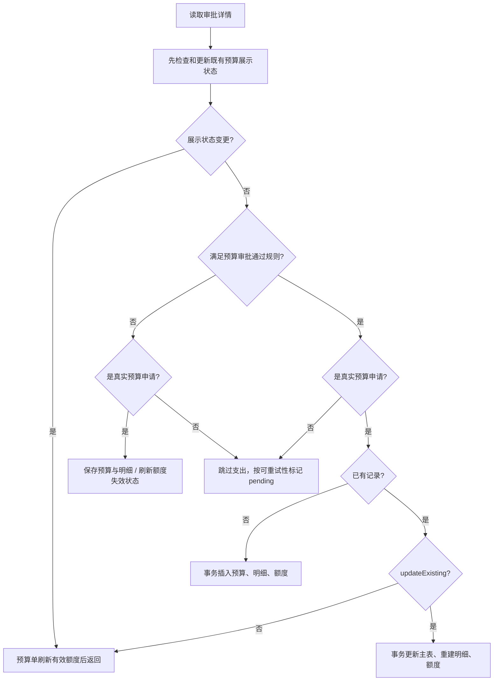

# 审批同步与调度：流程和状态

## 单实例同步

证据：[sync.js](../../../server/routes/sync.js) 的 `syncDingtalkInstance`、`insertRecord`、`updateRecord`、`refreshEffectiveBudgetQuota`。展示状态变更分支在检查 `updateExisting` 之前返回；不能宣称 `--update-existing` 每次都会重建全部字段。

## 状态判定的三种含义

| 判定 | 实际规则 |
| --- | --- |
| 主表展示状态 | 驳回结果/任务优先；COMPLETED+agree 为已通过；终止/取消及相关 bizAction 为已撤销；其他为审批中。初次解析 `parser.getStatus` 与状态刷新 `getStatusFromData` 的兼容字段不完全一致 |
| 预算生效 | `getApprovalState` 认可 COMPLETED+agree，及 TERMINATED+agree+finishTime；同时不能存在取消动作或拒绝任务 |
| 支出完成口径 | 仅 COMPLETED+最终同意+approval_completed_at；不复用预算 TERMINATED 兼容规则；付款事件另走记账规则 |

`getApprovalState` 结果不通过但未取消/拒绝时可重试；pending 预算会落库并在结果中保留 pending，以便后续复查。有效额度对不通过状态只将既有行标为 inactive，不创建新失效历史行。

证据：[sync.js](../../../server/routes/sync.js)、[parser.js](../../../server/services/parser.js)、[completed-expense-policy.js](../../../server/utils/completed-expense-policy.js)。

## 部门解析与事务

旧表单优先 DepartmentField 的稳定 ID，回退申请人部门 ID，再读取 OA 唯一部门路径。新服务主体字段存在时必须用主体 code 或主体+对应部门精确匹配当前组织；不能失败后悄悄改用申请人部门。无法解析时置空名称和 ID，标记 `service_entity_unresolved`。

主表、明细、有效额度在 insert/update 的同一事务内写入，更新明细采用删除后重建。既有状态刷新则先单独更新主表，再另开额度事务，可能出现状态成功但额度刷新失败。初始化 DDL 的 dept_name NOT NULL 与未解析名称为空存在冲突，目标库和异常单据处理待验证。

证据：[parser.js](../../../server/services/parser.js) 的部门解析、[department-tree.js](../../../server/services/department-tree.js) 的 `resolveServiceEntityDepartment`、[sync.js](../../../server/routes/sync.js) 的 `enrichBudgetDepartmentSnapshot`、[public.sql](../../../public.sql)。

## 每次定时运行

1. 读取状态 JSON；结束点为当前时间，开始点为 `lastCompletedEndTime`，首次按回看分钟数。
2. 按 pending 实例 ID 再查；插入成功/已有记录移除，仍可重试的保留，终态跳过移除。
3. 扫增量窗口，默认 `updateExisting:false`；收集新的 pending。
4. 按本次时间窗口对应预算月份刷新审批中记录，最多默认 200 条；失败记录到摘要。
5. 达到间隔时扫描最近 3 天回补窗口，收集 pending。
6. 推进游标，记录 lastRun、回补时间并写状态文件；在 finally 释放进程运行锁。

[scheduler.js](../../../server/services/scheduler.js) 为事实来源。该锁只限制使用它的进程内定时路径；HTTP POST `/sync` 和 `/expense-splits` 不通过此锁，也没有分布式协调。

## 失败和待验证事项

- `syncDingtalkData` 捕获单实例异常并继续，最终仍返回 success:true，未汇总 failed 数量；成功响应及推进游标不能证明每条都已同步。
- 钉钉列表模式只在新旧两种错误都存在时抛出；单模式 API 出错可能最后返回空列表。需结合错误日志核验“无实例”，不能直接判断业务为空。
- HTTP 普通支出同步失败会包装在 expenseSync.success=false，预算同步仍可成功；未配置地址会跳过。专项拆分未配置则直接报错。
- pending 与短期回补是否足以恢复所有异常历史记录、真实同步窗口和生产并发行为待验证；本次不触发同步或回填。

完整返回和默认参数见 [api.md](api.md)，状态存储见 [database.md](database.md)。

## 幂等、并发与恢复边界

| 环节 | 已有保障 | 尚未覆盖的情况 |
| --- | --- | --- |
| 预算主表 | 先按 form_no 查存在性；主表分别有 form_no 唯一约束；常规主表/明细/额度写入同事务 | 检查与插入不是原子 upsert，并发首次同步可能一方遇到唯一冲突；不能把顺序重跑可用等同并发已验证 |
| 有效额度 | 企业＋实例 ON CONFLICT 更新，科目同事务删除重建，不按重跑次数累加额度 | 没有按来源版本/更新时间拒绝旧快照覆盖新状态的统一检查；effective_at 会重写，不是追加式版本流水 |
| 状态刷新 | 主表刷新和独立额度事务各自提交 | 中间失败可能暂时不一致；后续重跑是否覆盖完整失败窗口需验证 |
| 调度状态 | 进程 isRunning、pending、增量及短期回补 | 无跨进程锁；HTTP 手动同步绕过调度锁；状态 JSON 直接 writeFile，未使用临时文件＋原子替换 |
| 外部支出 POST | 返回独立同步结果，设置 HTTP 超时 | 超时不能证明外部未写入；未确认外部幂等键/补偿流程前不能自动反复触发 |

依据：[sync.js](../../../server/routes/sync.js) 的 `syncDingtalkInstance/insertRecord/updateRecord/updateExistingBudgetStatus`、[额度服务](../../../server/services/effective-budget-quota.js) 的 `synchronizeEffectiveBudgetQuota`、[scheduler.js](../../../server/services/scheduler.js) 的状态写入及任务锁。数据库唯一键会阻止相同键产生重复行，但不保证冲突请求都返回成功。

后续验证应覆盖：同单并发首次写入、旧状态晚到、主表成功而额度失败、进程写状态时中断、外部同步超时但已完成。本次仅静态分析，不执行并发同步、故障注入或回填。跨系统责任见 [集成关系](../../knowledge/integrations.md)。
